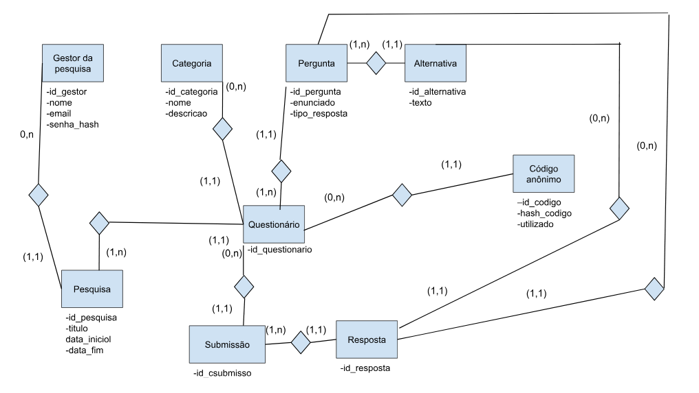

## Entidades:
GESTOR, CATEGORIA, PERGUNTA, ALTERNATIVA, QUESTIONÁRIO, CÓDIGO\_ANÔNIMO, PESQUISA, SUBMISSÃO e RESPOSTA.

Observação: Aluno não é uma entidade porque entidade é aquilo que o banco de dados armazena, enquanto o sistema foi pensado para não identificar quem responde o questionário. Aluno é então um ator (que interage com o sistema).

## Modelo Entidade-Relacionamento:

# Mapeamento:

Gestor: \*id\_gestor, nome, e-mail, senha  
Pesquisa: \*id\_pesquisa, titulo, data\_inicio, data\_fim, \--id\_gestor  
Categoria: \*id\_categoria, nome, descricao  
Questionário: \*id\_questionario, \--id\_pesquisa, –id\_categoria   
Pergunta: \*id\_pergunta,enunciado,tipo\_resposta,--id\_questionario  
Alternativa: \*id\_alternativa,texto,--id\_pergunta  
Participante: \*id\_codigo,hash\_codigo,utilizador (boolean),--id\_questionario  
Resposta: \*id\_resposta,--id\_pergunta,--id\_alternativa

# Normalização

O mapeamento atual está normalizado. Justificativa:
1 F.N : Todos os atributos são monovalorados e atômicos.
2 F.N : Campos não chave, dependem da chave primária.
3 F.N : Não tem atributos não chave que dependem de outro não chave.